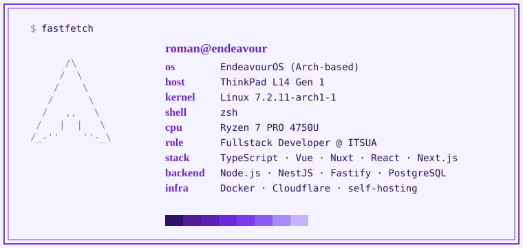

<picture>
  <source media="(prefers-color-scheme: dark)" srcset="./assets/card-purple-fastfetch-dark.svg">
  <source media="(prefers-color-scheme: light)" srcset="./assets/card-purple-fastfetch-light.svg">
  
</picture>

